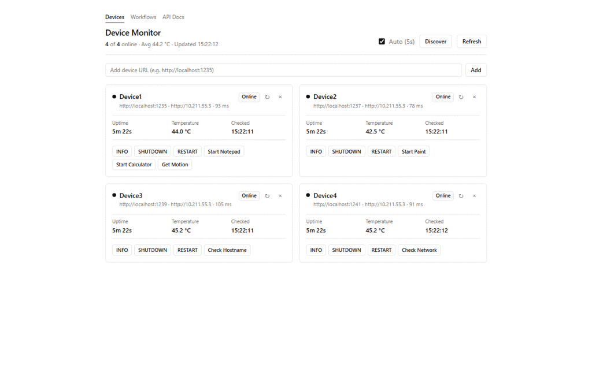
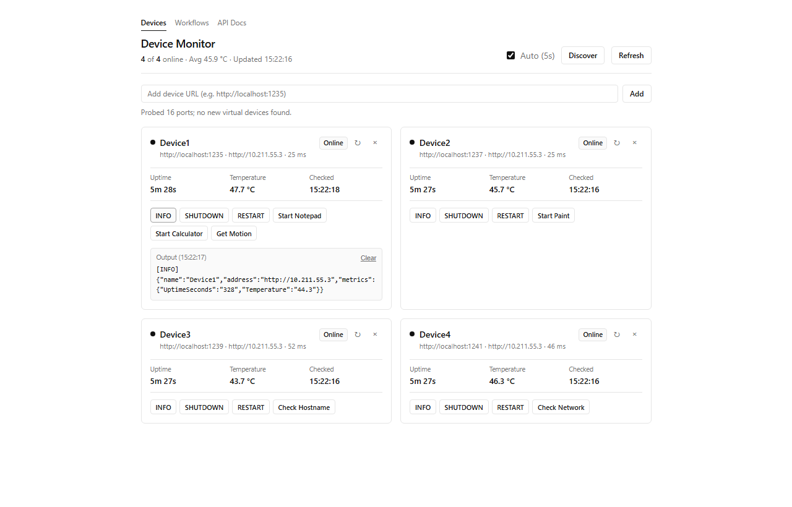
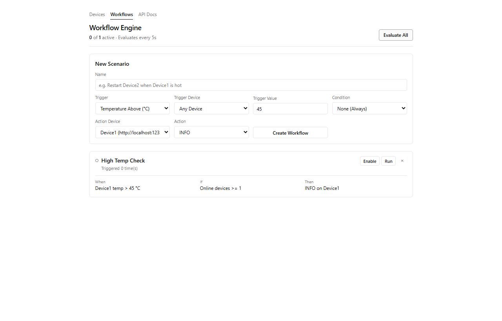
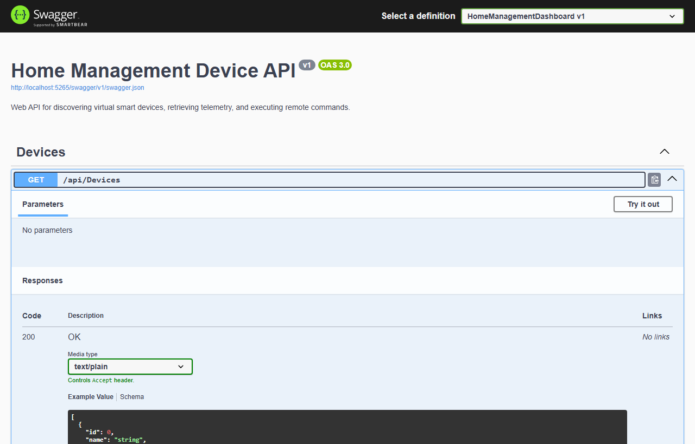

# Home Management — Smart Device API & Monitoring Dashboard

> Built as part of **DataArt IT Camp 2026: Build Your Edge**

A full-stack **.NET 10** IoT / edge device management solution consisting of a virtual smart device simulator, an auto-discovery & monitoring backend with **SQLite** persistence, a **REST Web API** with **Swagger/OpenAPI**, and a real-time **Blazor Interactive Server** dashboard with a rule-based workflow engine.

---

## Demo & Screenshots

### Live Walkthrough



### Device Monitor Dashboard



### Workflow Engine



### Swagger / OpenAPI Docs



---

## Architecture

1. **`HomeManagementDeviceApi`** — Virtual smart device simulator exposing `/info`, `/config`, `/command`, `/shutdown`, and `/restart` endpoints. Multiple instances can be run concurrently using launch profiles (`Device1`–`Device4`).
2. **`HomeManagementDashboard`** — Central management hub combining:
   * **Device Discovery** — Scans configurable local port ranges (`1235–1250` by default) to automatically detect and register running virtual devices.
   * **SQLite Persistence (EF Core)** — Stores managed devices, latest telemetry/action snapshots, command execution history, workflow rules, and workflow logs in `homemanagement.db`.
   * **REST Web API + Swagger** — Exposes endpoints for device management, discovery, telemetry retrieval, remote command execution, and command logs.
   * **Blazor Monitoring Dashboard & Workflows** — Real-time device status, temperature/uptime metrics, manual/remote actions, and automated trigger-condition-action workflows.

---

## How to Build

```cmd
dotnet build HomeManagementDeviceApi.slnx
```

---

## How to Run

### 1. Start the Simulated Virtual Devices

Open separate terminals in the root directory and run one or more device profiles (`Device1`–`Device4`):

```cmd
dotnet run --project HomeManagementDeviceApi.csproj --launch-profile Device1 --no-build
```

```cmd
dotnet run --project HomeManagementDeviceApi.csproj --launch-profile Device2 --no-build
```

* `Device1` listens on `http://localhost:1235` (`https://localhost:1234`)
* `Device2` listens on `http://localhost:1237` (`https://localhost:1236`)
* `Device3` listens on `http://localhost:1239` (`https://localhost:1238`)
* `Device4` listens on `http://localhost:1241` (`https://localhost:1240`)

### 2. Start the Management Dashboard & Web API

Open another terminal and run:

```cmd
dotnet run --project HomeManagementDashboard/HomeManagementDashboard.csproj
```

* **Dashboard UI:** `http://localhost:5265`
* **Swagger API Docs:** `http://localhost:5265/swagger`

---

## Web API Endpoints

| Method | Route | Description |
| --- | --- | --- |
| `GET` | `/api/devices` | List all managed devices and their latest telemetry |
| `GET` | `/api/devices/{id}` | Retrieve details and available actions for a device |
| `POST` | `/api/devices` | Register a new virtual device by `endpointUrl` |
| `DELETE` | `/api/devices/{id}` | Remove a managed device from the database |
| `POST` | `/api/devices/{id}/refresh` | Poll a device and update its stored telemetry |
| `POST` | `/api/devices/discover` | Scan local ports to discover and register virtual devices |
| `POST` | `/api/devices/{id}/commands` | Execute a device action (`INFO`, `RESTART`, `SHUTDOWN`, or custom) and log the result |
| `GET` | `/api/devices/{id}/logs` | Retrieve persisted command execution history for a device |
